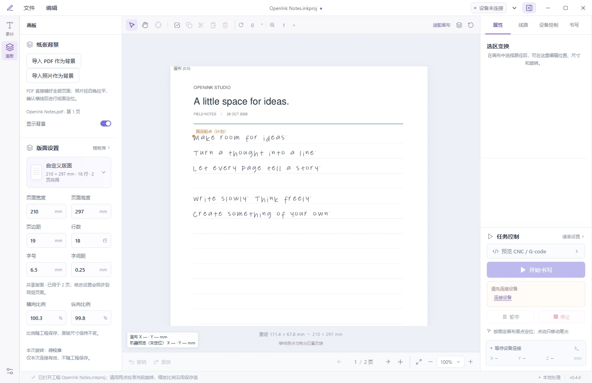
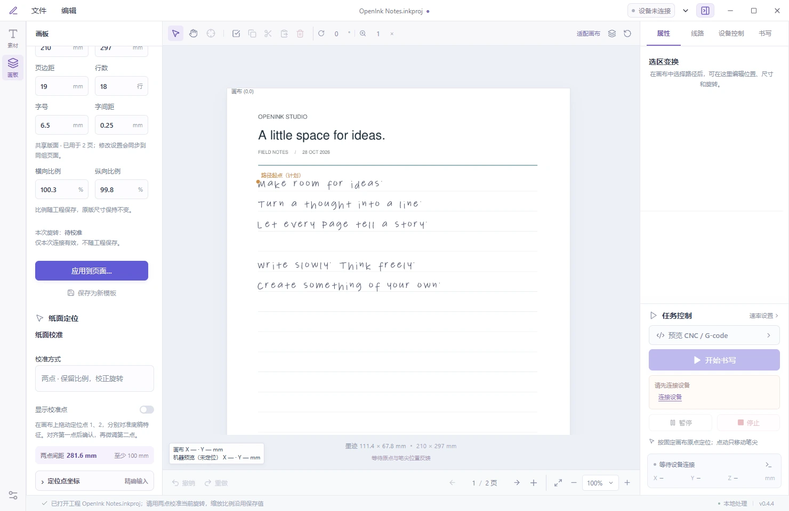
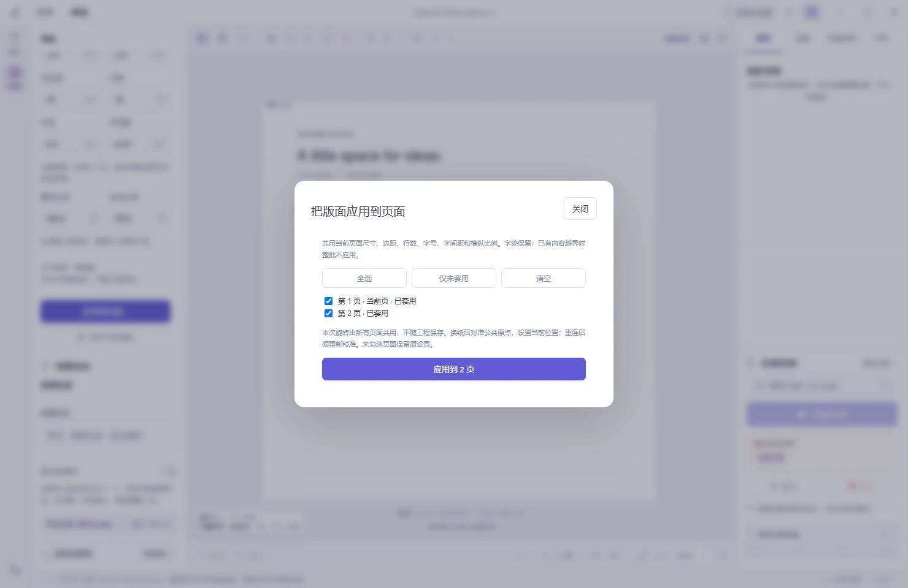

<h1 align="center">OpenInk Studio</h1>

<p align="center">
  
</p>

<p align="center">
  <strong>从 PDF、图片和 SVG 到纸面手写。</strong><br>
  本地桌面排版、纸面对位与 GRBL 写字机控制工作台。
</p>

<p align="center">
  <a href="#界面预览">界面预览</a> ·
  <a href="#从底稿到纸面">功能</a> ·
  <a href="#从源码启动">快速开始</a> ·
  <a href="./CHANGELOG.md">更新日志</a> ·
  <a href="./docs/README.md">文档</a>
</p>

源码预览 · Windows 开发与验证 · Rust / Tauri 2 / React · [GPL-2.0-only](LICENSE)

## 界面预览



<details>
<summary>查看版面比例与跨页应用</summary>

横纵比例随工程保存；旋转角标注为本次连接的临时值。



一次选择页面，同时应用版面与横纵比例。



</details>

## 从底稿到纸面

**导入底稿 → 编辑笔迹 → 对齐纸面 → 开始书写**，在同一个多页工程里完成。

### PDF 套打与纸面对位

整份 PDF 可作为多页背景导入，每页保留自己的字迹。将文字或 SVG 放到对应位置，再用底稿上的特征点完成校准。

- **两点校准**：修正等比缩放与旋转，两个定位点至少相距 100 mm。
- **三点校准**：修正横纵独立缩放与旋转，适合横纵比例不同的底稿。
- **逐点确认**：对齐第一点后，显式确认抬笔并移向下一点的预计位置，再点动微调。

横纵书写比例可按页面保存和复用；旋转仅本次连接有效。换纸后对准公共原点并确认当前位置，放纸角度改变时做两点对位。重连或重新打开工程后必须重新校准，不恢复旧机器坐标。

### 纸张照片：拉平、确认横线，再排版

拍下纸张后，用四角拉平透视，可选阴影净化。软件检测横线，你可以在画布上框选、移动、删除和撤销，确认后沿横线排字。

照片流程为 **导入背景 → 拉平与净化 → 确认横线 → 纸面定位**。背景仅用作底稿；要把图片内容转换成书写线路，使用素材导入。

### PNG / PDF：自动拟合线路，保留人工判断

将图片或 PDF 页面转换为中心线轨迹，预览后再插入画布。可调整阈值、平滑和拟合误差；PDF 支持用当前页面生成参数对照，检查点、钩和交叉处。

这是墨迹线路提取，**不是 OCR，也不保证恢复原始笔顺**。普通 TTF / OTF 字体可按轮廓或中心线生成；还可从自有素材框选字形，制作明文 JSON 中心线字库。

### 编辑笔迹与优选走线

直接在画布框选笔画，移动、缩放、旋转，支持复制粘贴、删除和撤销重做。不同来源的素材共用编辑层，编辑结果同步用于预览、导出和实际作业。

轨迹优化可重排笔序、选择整笔反向，减少抬笔空移；也可保留原笔顺。对照方案显示空移距离和估算用时，可按笔序检查单笔方向。估算不含加减速与通信等待，需结合字迹检查选择方案。

### 多页工程，保存后接着编辑

`.inkproj` 保存全部页面、可编辑笔迹、原始与处理后的背景、确认横线和排版设置。重新打开后继续编辑。轨迹可导出为 SVG 或 `openink-trajectories` JSON，再次导入使用。

## 从源码启动

以下为 Windows 开发流程。准备 Node.js、Rust stable 及对应的 C/C++ 构建工具、WebView2 Runtime、Python 3。

在仓库根目录执行：

```powershell
python -m pip install -r desktop/helpers/requirements.txt
powershell -ExecutionPolicy Bypass -File desktop/dev.ps1
```

启动脚本自动安装 npm 依赖并打开桌面开发窗口。**PDF / PNG 中心线转换还需自行安装 AutoTrace**，将 `autotrace.exe` 放入 PATH，或在设置面板指定路径；Python 路径也可在此设置。缺少 AutoTrace 时无法完成线路提取，详见 [转换依赖](docs/contracts/公开与私有构建.md#转换依赖)。

第一次使用建议先导入一份 SVG 或图片，在画布检查线路、缩放和编辑，再保存为 `.inkproj`。接机器前先完成设备笔高标定、手动归位与纸面对位；连接本身不会自动移动设备。

仅生成 SVG 的 G-code、暂不发送到设备：

```powershell
python tools/write_svg.py your-centerline.svg --dry-run
```

命令行串口工具另需 `pyserial`。构建与验证入口见 [开发说明](docs/contracts/公开与私有构建.md)。

## 使用边界

| 范围 | 当前边界 |
| --- | --- |
| 设备兼容 | 主要面向 GRBL 1.1；笔控与机械结构需分别验证，不能直接套用其他机器的参数 |
| 工作范围 | 软件按 A4（X210 / Y297 mm）检查；这是软件范围，物理行程尚未完整实测 |
| 坐标与恢复 | 手推机构、换纸或重连后重新校准；不自动寻零，不自动续写旧任务 |
| 书写进度 | 根据设备已有回报作软件判断，书写中不追加查询或逐笔等待 |
| 转换质量 | 位图可能漏笔、粘连或产生噪声，发送前检查预览；照片背景处理不能替代线路提取 |
| 发布与平台 | 当前只提供源码；跨平台代码结构不代表其他系统或所有 GRBL 设备已验收 |
| 背景草稿 | 关闭窗口时可选择保存、放弃或取消；尚未应用的图片背景设置不会写入工程 |

## 代码、许可与资料

项目围绕设备互操作与写字工作流开展研究和实现，与原厂无关联或授权。公开源码不分发原厂程序、反编译产物、字体样本、密钥或私有 gfont 实现；素材使用权仍需由使用者确认。此处不对全部实现来源或法律状态作绝对保证。

源码以 **GPL-2.0-only** 发布，见 [LICENSE](LICENSE)。依赖保留各自许可证。若制作并分发二进制，需先处理 `usvg`（Apache-2.0）、PDF helper 的 `PyMuPDF`（AGPL-3.0）与本项目许可证的组合分发兼容性，不能把源码公开等同于打包分发条件已满足。

默认构建关闭 gfont。私有开发版与公开版共用主线；私有构建显式启用 `private-gfont`。公开源码由私有主线导出到独立仓库，不共享开发仓库历史，也无需合并私有功能分支；导出规则与检查工具仅保留在私有仓库。具体操作见 [公开与私有构建](docs/contracts/公开与私有构建.md)。

| 入口 | 内容 |
| --- | --- |
| [开发与导出](docs/contracts/公开与私有构建.md) | 构建、转换依赖与两版维护 |
| [文档导航](docs/README.md) | 公开契约与定位图样 |
| [纸面对位](docs/contracts/PDF对位与两点校准.md) | 定位流程、坐标和校准边界 |
| [工程包协议](docs/contracts/工程包协议.md) | 多页工程的数据与兼容性 |
| `tools/` / `tests/` | Python 工具链与测试 |
