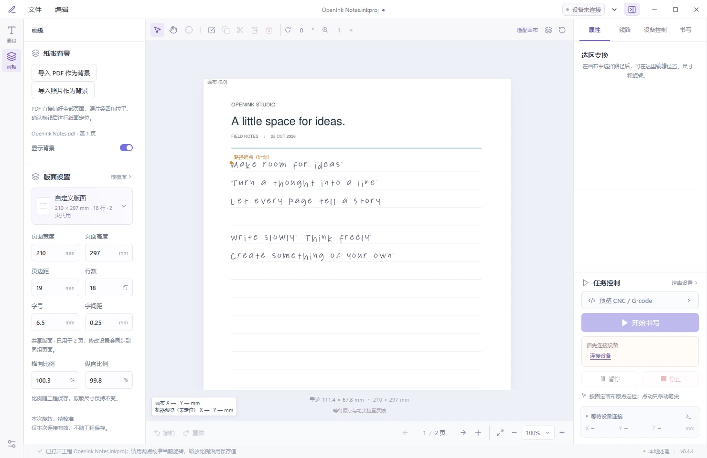
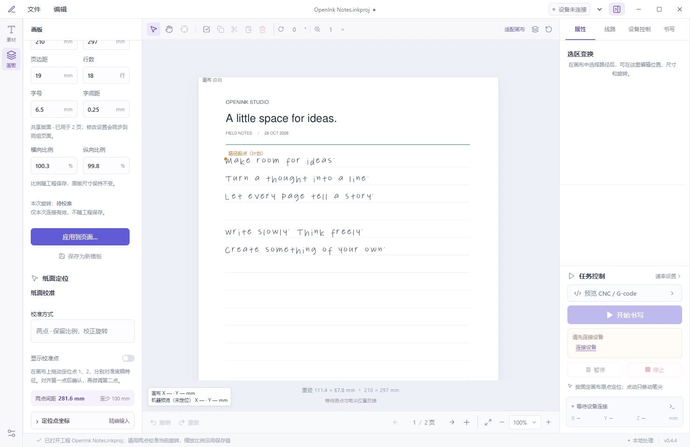
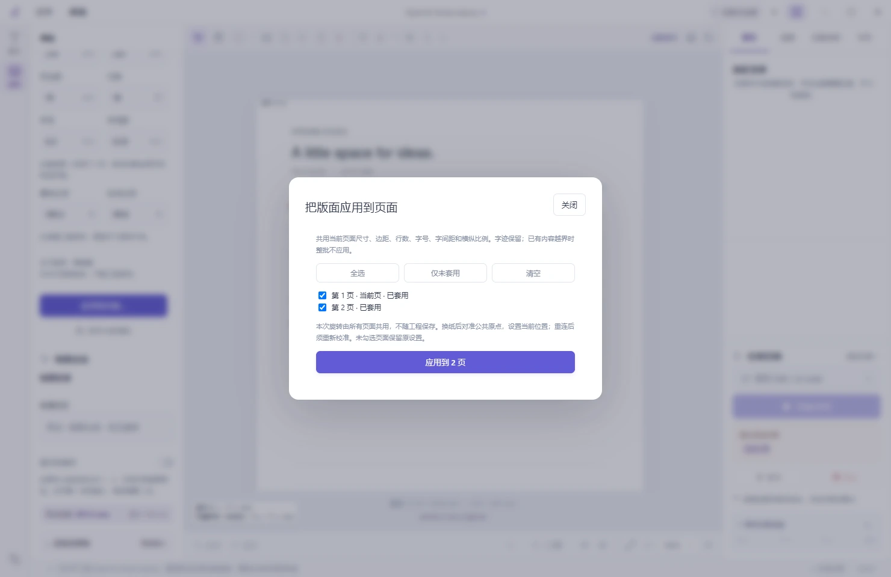
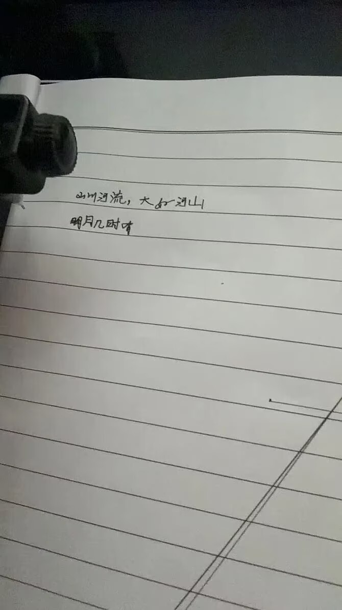
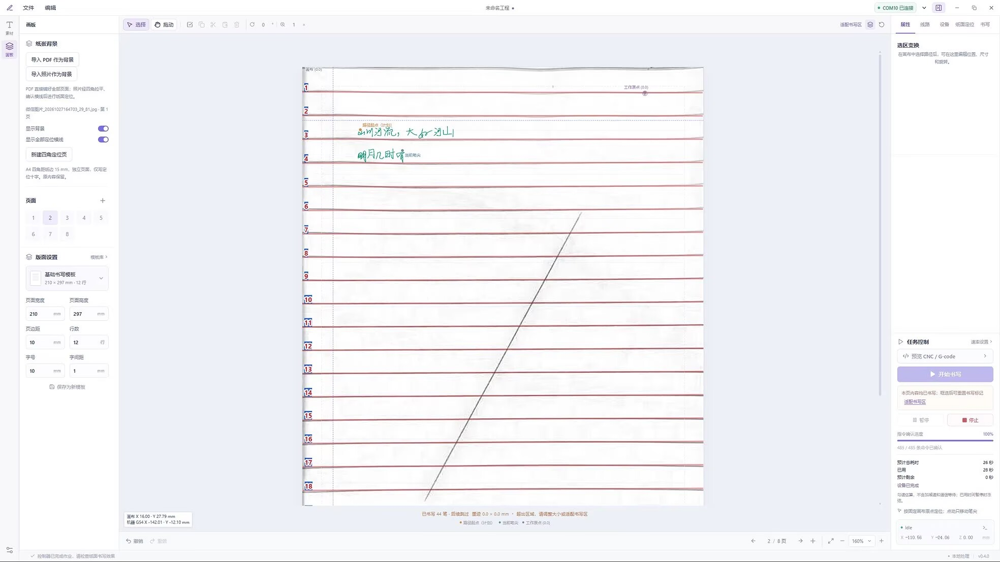
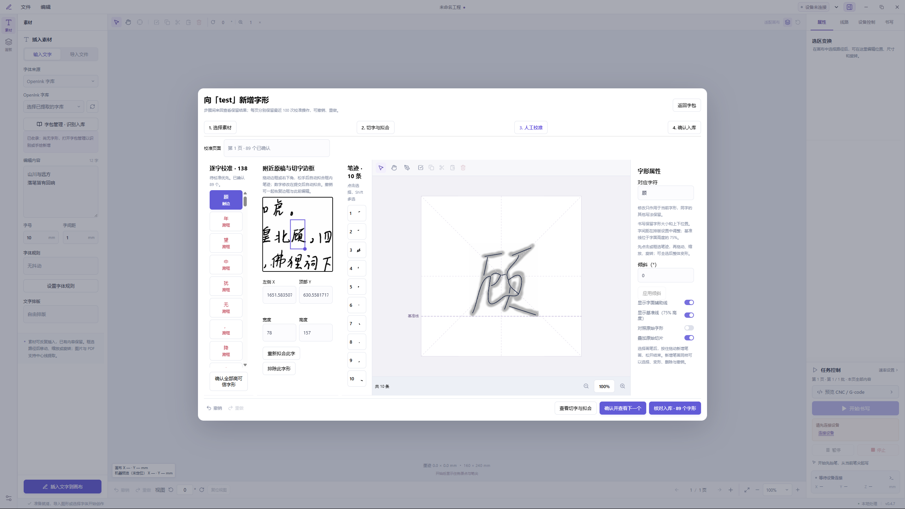

<h1 align="center">OpenInk Studio</h1>

<p align="center">
  
</p>

<p align="center">
  <strong>一切皆可手写</strong><br>
  将你的想象真实的写在纸上！
</p>

<p align="center">
  <a href="#界面预览">界面预览</a> ·
  <a href="#从底稿到纸面">功能</a> ·
  <a href="#从源码启动">快速开始</a> ·
  <a href="./CHANGELOG.md">更新日志</a> ·
  <a href="./docs/README.md">文档</a>
</p>

## 界面预览



<details>
<summary>查看版面比例与跨页应用</summary>

横纵比例随工程保存；旋转角标注为本次连接的临时值。



一次选择页面，同时应用版面与横纵比例。



</details>

## 他是怎么工作的？

我们将各种形式的**图像，文本，PDF**，转化为 **svg** 矢量图存储在画布上，然后在任务开始的时候将这些矢量图通过一些路径算法转化为机器可读的 **cnc** 代码

对于坐标系，我们通过 **两点/三点校准** 知道真实画面坐标系和当前软件坐标系的区别，然后让软件坐标系和真实坐标系意义对应

## 从底稿到纸面

**导入底稿 → 编辑笔迹 → 对齐纸面 → 开始书写**，在同一个多页工程里完成。

### PDF 套打与纸面对位

我们希望在编写的时候能够更加清晰的知道你的变更将在那里生效，而不是对着空白空想，于是我们允许导入pdf以及图片作为背景，同时使用两点/三点校准让软件坐标和机器坐标对齐。

整份 PDF 可作为多页背景导入，每页保留自己的字迹。将文字或 SVG 放到对应位置，再用底稿上的特征点完成校准。

- **两点校准**：修正等比缩放与旋转，适合打印机直接打印出来的稿件。
- **三点校准**：修正横纵独立缩放与旋转，适合横纵比例不同的底稿，如拍照录入的底稿。
- **逐点确认**：对齐第一点后，显式确认抬笔并移向下一点的预计位置，再点动微调。

### 纸张照片：拉平、确认横线，再排版

我们认为很多软件需要自己量纸张单行高度，宽度，不智能，也不直观，于是我们打算直接可以在“纸上”写，现在支持直接录入纸张底稿，自动识别横线位置，文字自动吸附/放置在横线上，无需手动量取

拍下纸张后，用四角拉平透视，可选阴影净化。软件检测横线，你可以在画布上框选、移动、删除和撤销，确认后沿横线排字。

照片流程为 **导入背景 → 拉平与净化 → 确认横线 → 纸面定位**。背景仅用作底稿；要把图片内容转换成书写线路，使用素材导入。

| 纸面实拍 | 软件执行 |
| --- | --- |
|  |  |

### PNG / PDF：自动拟合线路，保留人工判断

我们认为写字机不仅仅只能写字，而且也要能画图，同时也可以直接使用来自于其他方面的字体（如inktype 生成的手写字迹）我们希望将一切虚拟的都可以映射到纸上。

将图片或 PDF 页面转换为中心线轨迹，预览后再插入画布。可调整阈值、平滑和拟合误差；PDF 支持用当前页面生成参数对照，检查点、钩和交叉处。

这是墨迹线路提取，**不是 OCR，也不保证恢复原始笔顺**。普通 TTF / OTF 字体可按轮廓或中心线生成；还可从自有素材框选字形，制作明文 JSON 中心线字库。

### 编辑笔迹与优选走线

我们认为编辑应该是自由的，可以编辑任何内容而不是只能变更文本输入输出。

直接在画布框选笔画，移动、缩放、旋转，支持复制粘贴、删除和撤销重做。不同来源的素材共用编辑层，编辑结果同步用于预览、导出和实际作业。

轨迹优化可重排笔序、选择整笔反向，减少抬笔空移；也可保留原笔顺。对照方案显示空移距离和估算用时，可按笔序检查单笔方向。估算不含加减速与通信等待，需结合字迹检查选择方案。

### 多页工程，保存后接着编辑

我们希望使用软件过程中整个流程是和你书写真实文章是类似的，所以支持一次性编辑多页，然后一次性书写

`.inkproj` 保存全部页面、可编辑笔迹、原始与处理后的背景、确认横线和排版设置。重新打开后继续编辑。轨迹可导出为 SVG 或 `openink-trajectories` JSON，再次导入使用。

## 特色功能

根据真实反馈，我们收集并且制作了一些独有的功能，只为能帮到你

### 多批次任务

我们发现，如果一页需要用多种颜色，那么当前的流程是不能满足的，所以我们做了多批次任务，机器做路径规划的时候会隔离每个批次的任务，每次完成一个批次任务后停下，方便你换笔。

### 完整的字体系统

我们希望为用户提供完善的 **字体录入 → 字体编辑 → 字体使用** 的字体使用体验

- 字体录入：支持从自己的手写体、PDF 和照片制作字库，软件会自动完成切字、字型识别；高可信度的可以一键批准，其余的也可以手动修正字型、重新切字。原版 gfont 导入仅在私有构建中提供，公开版不包含此能力。
- 字体编辑：字体录入后，可以重新更改字型（如增添笔画）一个字体可以拥有多个写法
- 字体使用：搭配照片的自动排版，可以一键将字体放置在横线上，同时支持多种排版，字体大小，字间距，行间距等设置



### 线路优化

我们希望尽可能的节省用户的时间，提供多种路径规划算法

- 不在以真正字体怎么写为准，而是以“怎样最快写完”为目的
- 允许设置连笔，禁止重复笔画，进一步节省时间
- 提供完善的时间对照参考，清晰的知道能节省多久时间

### 坐标系设置

机器的控制权应该由我们自己掌握，现在你能自己决定你想怎么写字

- 允许对调x,y 轴
- 允许自定义坐标原点
- 允许变更画布方向而不变更机器坐标方向（允许纸张横着放在机器上进行书写）

## 从源码启动

以下为 Windows 开发流程。准备 Node.js、Rust stable 及对应的 C/C++ 构建工具、WebView2 Runtime、Python 3。

在仓库根目录执行：

```powershell
python -m pip install -r desktop/helpers/requirements.txt
powershell -ExecutionPolicy Bypass -File desktop/dev.ps1
```

启动脚本自动安装 npm 依赖并打开桌面开发窗口。**PDF / PNG 中心线转换还需自行安装 AutoTrace**，将 `autotrace.exe` 放入 PATH，或在设置面板指定路径；Python 路径也可在此设置。缺少 AutoTrace 时无法完成线路提取，详见 [转换依赖](docs/contracts/公开与私有构建.md#转换依赖)。

第一次使用建议先导入一份 SVG 或图片，在画布检查线路、缩放和编辑，再保存为 `.inkproj`。接机器前先完成设备笔高标定、手动归位与纸面对位；连接本身不会自动移动设备。

仅生成 SVG 的 G-code、暂不发送到设备：

```powershell
python tools/write_svg.py your-centerline.svg --dry-run
```

命令行串口工具另需 `pyserial`。构建与验证入口见 [开发说明](docs/contracts/公开与私有构建.md)。

## 使用边界

| 范围 | 当前边界 |
| --- | --- |
| 设备兼容 | 主要面向 GRBL 1.1；笔控与机械结构需分别验证，不能直接套用其他机器的参数 |
| 坐标与恢复 | 手推机构、换纸或重连后重新校准；不自动寻零，不自动续写旧任务 |
| 书写进度 | 根据设备已有回报作软件判断，书写中不追加查询或逐笔等待 |
| 转换质量 | 位图可能漏笔、粘连或产生噪声，发送前检查预览；照片背景处理不能替代线路提取 |
| 发布与平台 | 当前只提供源码；跨平台代码结构不代表其他系统或所有 GRBL 设备已验收 |
| 背景草稿 | 关闭窗口时可选择保存、放弃或取消；尚未应用的图片背景设置不会写入工程 |

## 代码、许可与资料

项目围绕设备互操作与写字工作流开展研究和实现，与原厂无关联或授权。公开源码不分发原厂程序、反编译产物、字体样本、密钥或私有 gfont 实现；素材使用权仍需由使用者确认。此处不对全部实现来源或法律状态作绝对保证。

源码以 **GPL-3.0-only** 发布，见 [LICENSE](LICENSE)。依赖保留各自许可证。若制作并分发二进制，需先处理 `usvg`（Apache-2.0）、PDF helper 的 `PyMuPDF`（AGPL-3.0）与本项目许可证的组合分发兼容性，不能把源码公开等同于打包分发条件已满足。

默认构建关闭 gfont。私有开发版与公开版共用主线；私有构建显式启用 `private-gfont`。公开源码由私有主线导出到独立仓库，不共享开发仓库历史，也无需合并私有功能分支；导出规则与检查工具仅保留在私有仓库。具体操作见 [公开与私有构建](docs/contracts/公开与私有构建.md)。

| 入口 | 内容 |
| --- | --- |
| [开发与导出](docs/contracts/公开与私有构建.md) | 构建、转换依赖与两版维护 |
| [文档导航](docs/README.md) | 公开契约与定位图样 |
| [纸面对位](docs/contracts/PDF对位与两点校准.md) | 定位流程、坐标和校准边界 |
| [工程包协议](docs/contracts/工程包协议.md) | 多页工程的数据与兼容性 |
| `tools/` / `tests/` | Python 工具链与测试 |
